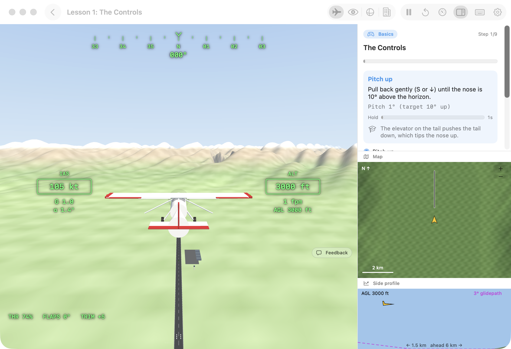
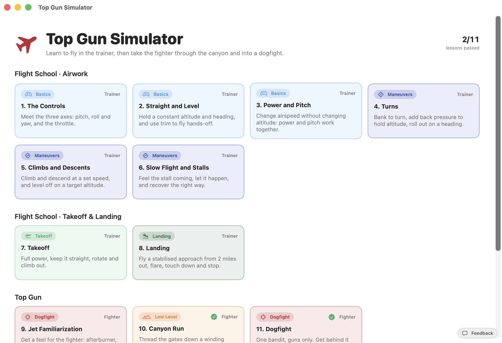
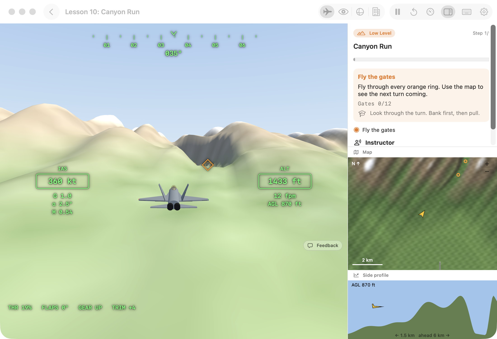
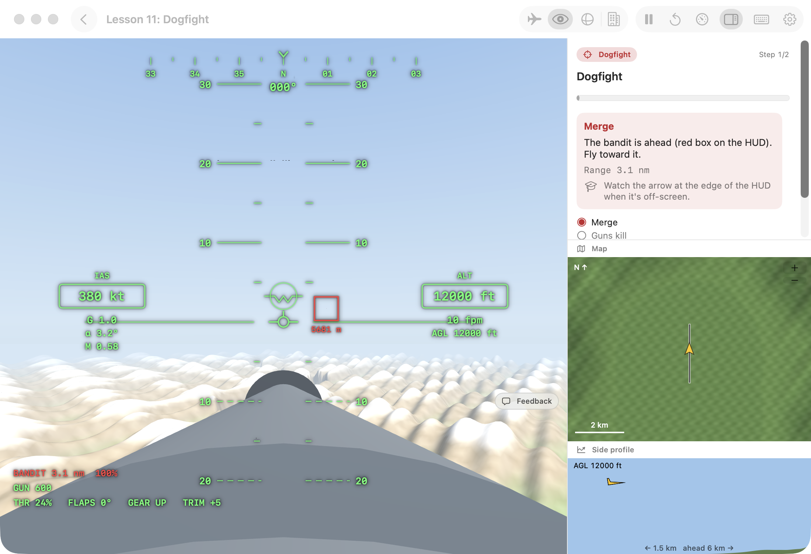
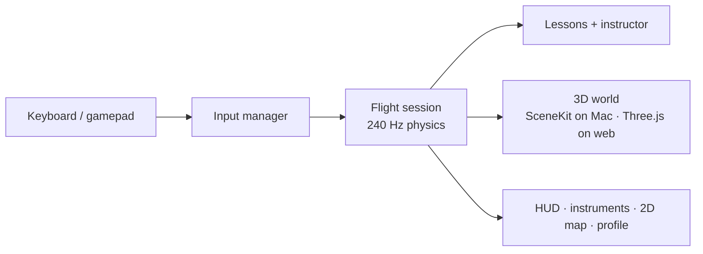
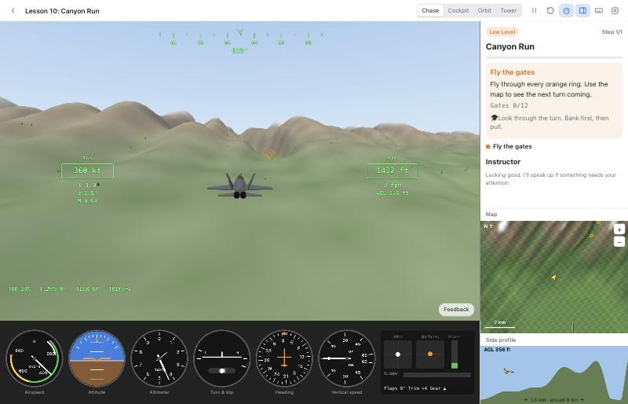

# Top Gun Simulator

A flight simulator for the Mac and the web that teaches you to fly: real aerodynamics, a live instructor, 11 guided lessons from "what does the stick do" to landing, then a fighter jet for a canyon run and a guns-only dogfight.

| Flight school | Canyon run | Dogfight (cockpit) |
|---|---|---|
|  |  |  |

**[Play it in your browser →](https://amalmehta.github.io/TopGunSimulator/)**

- **[How to build, run and fly](docs/INSTRUCTIONS.md)**
- **[System design](docs/SYSTEM-DESIGN.md)**
- **[What's where](docs/FILE-STRUCTURE.md)**
