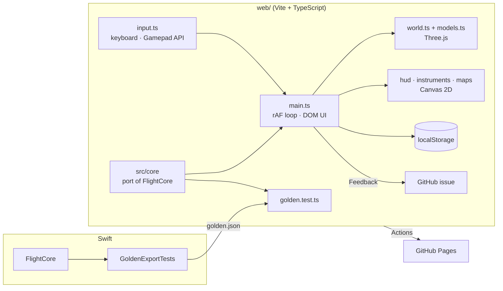

# Top Gun Simulator: System Design

## Architecture

The project ships twice from one design: a **Mac app** (Swift) and a **website** (TypeScript, in `web/`). The web version is a line-for-line port of `FlightCore` plus a browser UI; see [Web version](#web-version).

Two Swift targets. `FlightCore` is pure simulation: no UI, fully unit-tested. `TopGunSimulator` is the SwiftUI + SceneKit Mac app that drives and displays it.

```mermaid
flowchart TB
    subgraph App["TopGunSimulator (SwiftUI + SceneKit)"]
        Input[InputManager<br/>keyboard · GameController]
        Ctrl[SimulationController<br/>120 Hz timer, events, snapshots]
        World[WorldScene<br/>terrain · airport · models · cameras]
        UI[HUD · InstrumentPanel · Sidebar<br/>Map · Profile · Lesson · Instructor]
        Prefs[(UserDefaults<br/>settings · lesson progress)]
        FB[(feedback.jsonl)]
    end
    subgraph Core["FlightCore (pure Swift)"]
        Session[FlightSession]
        Aircraft[Aircraft<br/>6-DOF flight model]
        Spec[AircraftSpec<br/>trainer · fighter]
        Env[Atmosphere · Terrain · Wind]
        Lessons[LessonCatalog · LessonProgress]
        Instr[Instructor]
        Combat[BanditAI · guns · gates]
    end
    Input --> Ctrl
    Prefs --> Ctrl
    Ctrl -->|advance(by:)| Session
    Session --> Aircraft --> Spec
    Aircraft --> Env
    Session --> Lessons
    Session --> Instr
    Session --> Combat
    Ctrl -->|state each frame| World
    Ctrl -->|FrameSnapshot ~30 Hz| UI
    UI --> FB
```

## Components

| Component | Job |
|---|---|
| `Aircraft` (FlightModel.swift) | Rigid-body 6-DOF physics: aero forces and moments from stability derivatives, a lift curve with stall break and flat-plate post-stall, induced drag with ground effect, prop/jet thrust with spool-up, propeller turning tendency, spring-damper landing gear with steering, brakes and friction, crash and touchdown detection. Also the control laws: direct linkage plus optional auto-rudder (trainer), or fly-by-wire with pitch damper, g- and alpha-limiters and roll-rate command (fighter). |
| `AircraftSpec` | Data for the Cessna-172-like trainer and F/A-18-like fighter: mass, inertia, geometry, aero derivatives, thrust, gear geometry, reference speeds. |
| `Atmosphere`, `Terrain`, `WindModel` | ISA density; an analytic height field (flat airport and approach corridor, hills, a northern range cut by a winding canyon); steady wind plus filtered-noise turbulence. |
| `FlightSession` | One flight: fixed 240 Hz stepping, player and bandit, gates, guns, trails, the event queue, and the lesson and instructor. |
| `LessonCatalog` / `LessonProgress` | 11 lessons. Each step is a check closure that must hold for N seconds, an optional fail closure and a live progress readout. |
| `Instructor` | Turns telemetry into prioritised hints, each with a "why" (stall, sink rate, slip, over-g, trim, rotate…). |
| `BanditAI` | Steers a second `Aircraft` with the same physics: lead pursuit, roll the target into the lift vector, terrain avoidance, fires when in its gun cone. |
| `SimulationController` | Main-thread loop: samples input, advances the session, turns events into toasts and results, pushes state to SceneKit every tick and a `FrameSnapshot` to SwiftUI at ~30 Hz. |
| `WorldScene` / `AircraftModels` | Builds the terrain mesh (vertex-coloured), runway with markings, lights and live PAPI, buildings, trees and gates. Aircraft are built from primitives with hinged ailerons, elevator, rudder and flaps that deflect, plus prop and afterburner. Runs chase, cockpit, orbit and tower cameras, tracers and explosions. |
| HUD / instruments / sidebar | Canvas-drawn HUD (pitch ladder and flight-path marker in the cockpit), six-pack, stick-vs-surface readout, moving map, side profile with glidepath, lesson and instructor panels. |
| Settings / Feedback | Settings window (⌘,) backed by `UserDefaults`; feedback appended to a local JSON-lines file. |
| `OnScreenControls` / `OnScreenControlsView` | Optional mouse/trackpad stick, rudder, throttle and buttons over the 3D view (mirrors the web touch controls). The stick mapping and the merge into `PilotInput` live in `FlightCore` and are unit-tested; the SwiftUI view only sets that state from drag gestures. |

## Main flows

1. **Frame:** a 120 Hz timer → `InputManager.sample` → `FlightSession.advance(by: dt)` runs `floor(dt × 240)` physics steps → telemetry, instructor and lesson update → events drained (toasts, pass/fail, crash) → `WorldScene.update` moves nodes and cameras → every ~33 ms a `FrameSnapshot` is published to SwiftUI.
2. **Lesson:** `SessionMode.lesson` places the aircraft from `LessonStart`. Each frame the current step's `check` runs against telemetry plus mission context (gates, bandit range, touchdown); holding it for `hold` seconds advances the step. A `fail` closure or a crash ends the lesson. Passing records the lesson id in `UserDefaults`.
3. **Physics step:** air-relative velocity in body axes → α, β, q̄ → control law → coefficients → body forces and moments → gear contacts → integrate velocity, position, angular rate (Euler's equations) and the orientation quaternion.

## Where data lives

- Settings and passed lessons: `UserDefaults` (domain `com.amalmehta.topgunsimulator`).
- Feedback: `~/Library/Application Support/Top Gun Simulator/feedback.jsonl`.
- No network access, no accounts, and no files are read from the user.

## Key decisions and trade-offs

- **Stability-derivative model, not blade-element:** mid-fidelity is enough to teach real stick-and-rudder behaviour (stalls, trim, adverse yaw, P-factor, ground effect) while staying small and deterministic. Mach effects, engine systems and weight and balance are left out.
- **Body axes match SceneKit** (−Z forward, +Y up), so the physics quaternion drives nodes directly. Aero quantities are converted to conventional p/q/r and α/β for the maths and the instruments.
- **Fixed 240 Hz substeps** with semi-implicit Euler keep the stiff gear springs stable and make tests deterministic.
- **Pure `FlightCore`** lets tests fly whole lessons with a scripted pilot without any UI.
- **Analytic terrain** is shared by physics, rendering and both 2D views, so they always agree. The cost is that it isn't real-world scenery.
- **SceneKit primitives** instead of imported 3D assets: no asset pipeline and animated control surfaces for free, but simpler-looking aircraft.
- **Main-thread loop** (Timer) instead of the SceneKit render thread: simpler under Swift concurrency, and physics costs well under 1 ms per frame.
- **Auto-rudder on by default** for learners, including a heading-hold on the takeoff roll. It can be turned off in Settings to feel adverse yaw and P-factor.

## Testing

`swift test` runs 30 XCTest cases (plus an opt-in golden export) in `Tests/FlightCoreTests`: ISA values, terrain shape, Euler round-trip, hands-off trim stability (both aircraft), control response directions, the lift curve and stall, stall and recovery, takeoff distance and tracking, sitting still on the runway, fighter takeoff and gear, the g-limiter, gentle vs. hard landings, gate crossing, gun cone, bandit merge, instructor priorities, every lesson starting cleanly, steps not advancing early, the flat approach corridor, scripted pilots passing the Controls and Takeoff lessons, and the on-screen controls (stick mapping, dead zone, input merge, throttle handover). On the web, `npm --prefix web test` runs 37 Vitest cases (golden trajectory replays, ports of the key Swift tests, touch stick/input/wording tests, and tilt maths: neutral, directions, range setting, dead zone, iOS sign, landscape, stick override), and the site was checked in a browser at desktop and phone sizes. The Mac app was checked by launching it with `--start` flags and capturing window screenshots (`scripts/screenshot.sh`).

## Web version



- **Same physics, proven:** `src/core` mirrors each Swift file (math, environment, aircraft, telemetry, instructor, lessons, session) and keeps the same names and constants. A Swift test exports reference trajectories (trimmed manoeuvres, a full takeoff, a fighter max-g pull, a stall), and `golden.test.ts` replays them: velocities agree to 1e-3 m/s and attitude quaternions to 1e-5. The SplitMix64 RNG is reproduced bit-for-bit with BigInt, so turbulence matches too.
- **Frame loop:** `requestAnimationFrame` samples input, advances the session at fixed 240 Hz steps, updates Three.js every frame and redraws the HUD each frame. Instruments, map, profile and the sidebar redraw at ~30 Hz, and the sidebar DOM is rebuilt only when its content changes.
- **UI without a framework:** plain DOM and template strings keep the bundle to Three.js plus about 60 kB of app code. The panels are Canvas 2D ports of the SwiftUI Canvas drawing.
- **Data:** settings and passed lessons are in `localStorage` (wrapped in try/catch; the app still works when storage is blocked). Feedback opens a pre-filled GitHub issue on the repo, so no server is needed.
- **Deploy:** `.github/workflows/pages.yml` runs `npm test` and `npm run build` with `PAGES_BASE=/TopGunSimulator/`, then publishes `web/dist` to Pages.
- **Touch controls** (`src/app/touch.ts`): a virtual stick, rudder pedals, throttle slider and action buttons layered over the 3D view. Each control tracks its own pointer id, so stick and throttle work at the same time. Output is a `TouchState` that `InputManager.sample` merges with keyboard and gamepad input (touch wins while a finger is on it). They turn on automatically for coarse pointers (`touchControls: auto`). On phones a compact layout hides the instrument panel (and the sidebar in landscape) and adds a lesson strip. The HUD's readouts move up out of the controls' way, and `touchText()` rewrites key hints ("(S / ↓)" → "(drag the stick down)") in lesson and instructor text.
- **Tilt to fly** (`src/app/tilt.ts`, optional, off by default): reads `devicemotion` `accelerationIncludingGravity` rather than the beta/gamma orientation angles. Those flip near vertical, which is how people hold a phone in landscape. The gravity vector is rotated into screen axes using `screen.orientation.angle`, and the axis sign is normalised so iOS and Android agree (the screen faces up at calibration). Roll and pitch are measured relative to a neutral hold captured at flight start or by the Level button: The Tilt for full stick setting (10–60°, default 30°) gives full stick, with a 2° dead zone. `InputManager` uses tilt unless a finger is on the on-screen stick. iOS motion permission is requested from the Settings toggle or the in-flight "Enable tilt" button, since it needs a user gesture.
- **Trade-offs:** two codebases must stay in sync (the golden test catches physics drift but not UI drift). The terrain mesh is generated on the main thread at startup, which takes about a second.

## Known limits

- The keyboard is a coarse stick, so a game controller flies much better. There is no mouse-yoke mode.
- No sound, weather visuals, night or multiplayer.
- The bandit is a single pursuit AI. It doesn't do energy tactics or defensive breaks.
- The landing lesson is graded on touchdown sink rate and runway position, not on a full approach-stability score.
- Startup takes a few seconds while the terrain mesh and map image are generated.
- Touch controls are less precise than a gamepad. Tilt-to-fly was tested with unit tests and synthetic motion events, not yet on a physical phone.
